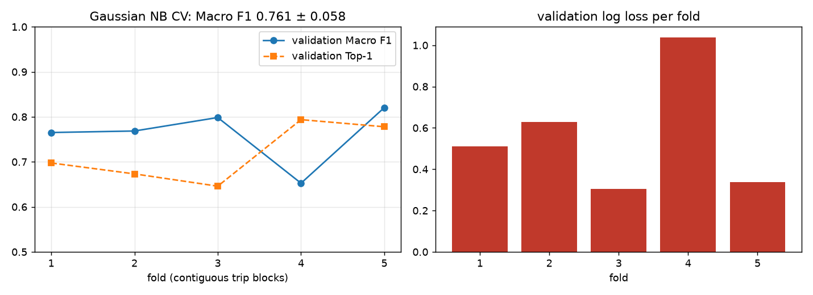
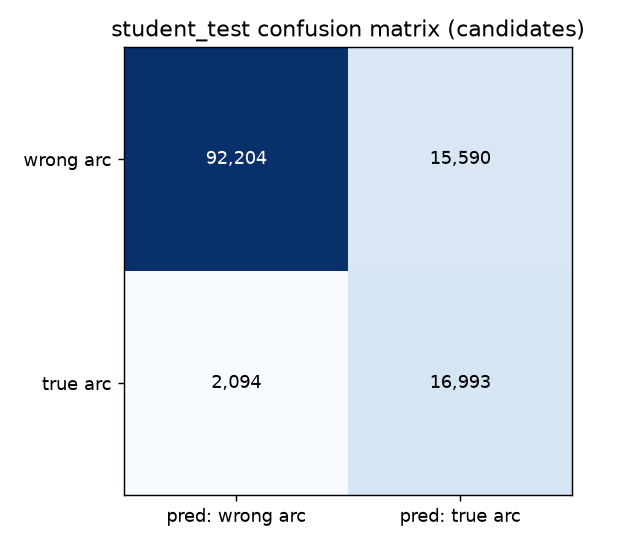
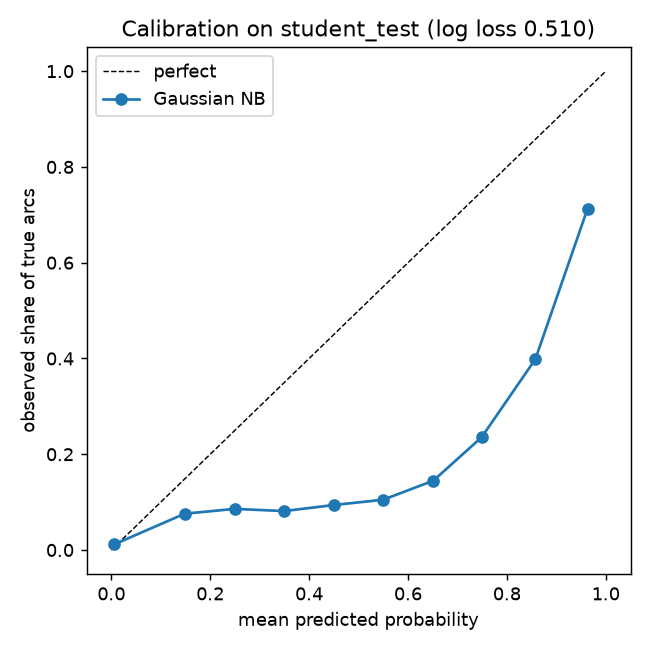
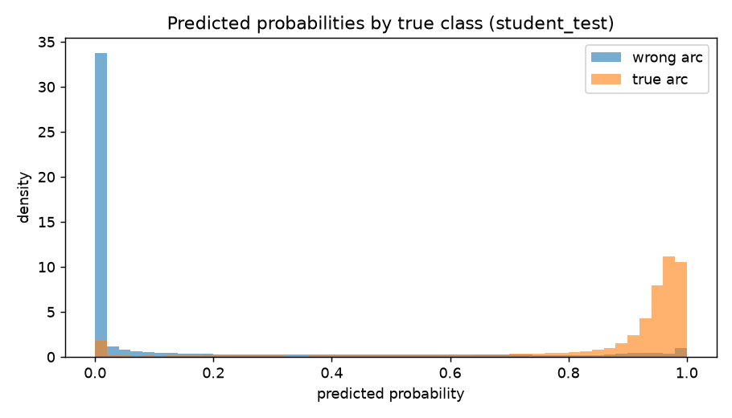
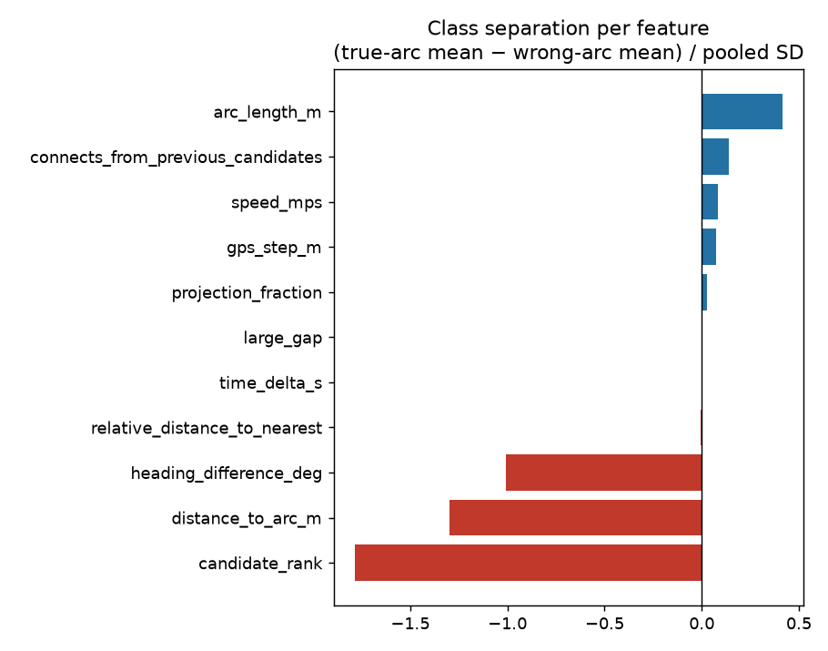

# Gaussian Naive Bayes — Aditya Rao (PES2UG24CS034)

Candidate classifier on the team's Phase 1 candidate table: for each (GPS observation, candidate arc) it estimates
one Gaussian per feature for the "true arc" and "wrong arc" classes and applies Bayes' rule, assuming the features
are independent within a class. The highest-probability candidate per observation is the classifier-only
prediction; the probabilities are candidate emission scores for the later HMM/Viterbi stage.

## Reproduce

```powershell
python scripts/run_phase1.py --data-root "data/Student folder" --partitions train --output-dir outputs/train_all --radius-m 80 --max-candidates 8
python scripts/run_phase1.py --data-root "data/Student folder" --partitions student_test --output-dir outputs/student_test_all --radius-m 80 --max-candidates 8
python models/gaussian_nb/train_gnb.py `
  --train-features outputs/train_all/candidate_features.csv `
  --train-diagnostics outputs/train_all/candidate_diagnostics.csv `
  --student-test-features outputs/student_test_all/candidate_features.csv `
  --student-test-diagnostics outputs/student_test_all/candidate_diagnostics.csv `
  --output-dir outputs/gaussian_nb
python models/gaussian_nb/make_plots.py --results outputs/gaussian_nb --dataset "data/Student folder" --map-trip 00000052
```

`make_plots.py` only reads the saved outputs (`cv_folds.csv`, `summary.json`, `student_test_predictions.csv`,
`gaussian_nb.pkl`); it does not retrain, so every plotted number comes from the training run above.

## Features

- **Inputs (11):** `distance_to_arc_m`, `projection_fraction`, `arc_length_m`, `candidate_rank`, `relative_distance_to_nearest`, `heading_difference_deg`, `gps_step_m`, `time_delta_s`, `speed_mps`, `large_gap`, `connects_from_previous_candidates`.
- All are available at inference time without `.route`. Route-derived columns (reference arc, alignment distance), identifiers, timestamps and labels are excluded.
- Candidates come from the Phase 1 pipeline: up to 8 arcs within 80 m of each GPS observation.

## Model

- **Preprocessing (fitted inside each fold on that fold's training trips only):** median imputation of non-finite values, then standardisation.
- **Classifier:** Gaussian Naive Bayes implemented in numpy (`train_gnb.py`). Per class it stores a prior, a mean and a variance for every feature; `variance_smoothing = 0.0001` is added to each variance for numerical stability.
- **Training objective:** maximum-likelihood estimates of the class priors and per-class Gaussian parameters (closed form, no iterations, so there are no loss curves).
- **Prediction:** posterior P(true arc | features) from Bayes' rule with the independence assumption.
- **Class imbalance:** handled through the learned class prior (14.5% of training candidate rows are true arcs); no reweighting.

## Protocol

- 5-fold group-aware CV by trip_id on the 80 train trips (1,272,257 candidate rows). Folds are contiguous blocks of trip IDs (`np.array_split` of the sorted IDs), so no trip appears in both training and validation.
- Final model refit on all 80 train trips, then one evaluation on the 10 student_test trips (126,881 candidates, 19,160 observations).
- Random seed 42 (the model itself is deterministic).
- All train trips are used, including `00000033` and `00000054`, whose GPS lies mostly away from the reference route (Random Forest excludes these two).

## Hyperparameters (`config.json`)

`variance_smoothing` 0.0001, 5 CV folds, seed 42, candidate radius 80 m, at most 8 candidates.

## Results (student_test, 10 trips)

| Metric | Value |
| --- | --- |
| CV Macro F1 (mean ± std over 5 folds) | 0.7610 ± 0.0579 (population std; sample std 0.0648) |
| Student-test Macro F1 | 0.7851 |
| Top-1 accuracy | **0.7839** |
| Candidate accuracy | 0.8606 |
| Precision / recall (true-arc class, threshold 0.5) | 0.5215 / 0.8903 |
| Log loss | 0.5096 |
| Candidate miss rate | 0.0038 |
| Training / inference time | 0.87 s / 0.066 s |

Confusion matrix (candidate level, threshold 0.5): TN 92,204 · FP 15,590 · FN 2,094 · TP 16,993.

Per-fold validation scores:

| Fold | Validation trips | Macro F1 | Top-1 | Precision | Recall | Log loss |
| --- | --- | --- | --- | --- | --- | --- |
| 1 | 00000001–00000020 | 0.7651 | 0.6974 | 0.4932 | 0.8435 | 0.5113 |
| 2 | 00000021–00000038 | 0.7685 | 0.6732 | 0.4969 | 0.8859 | 0.6298 |
| 3 | 00000039–00000058 | 0.7984 | 0.6459 | 0.5229 | 0.9066 | 0.3034 |
| 4 | 00000060–00000080 | 0.6525 | 0.7937 | 0.3358 | 0.9615 | 1.0373 |
| 5 | 00000081–00000099 | 0.8204 | 0.7779 | 0.6094 | 0.8409 | 0.3368 |

## Analysis

- **Probability quality is the main weakness.** 71% of student_test probabilities are below 0.05 or above 0.95, and the calibration curve lies far below the diagonal: candidates scored around 0.9 are true arcs only about 40–70% of the time. This is the expected effect of the independence assumption on correlated features (distance, distance rank and relative distance all measure closeness), and it drives the high log loss (0.510). If used in the HMM, these probabilities should be recalibrated or tempered.
- **Recall over precision.** The model finds 89% of true arcs, but only 52% of its positive calls are correct (15,590 false positives), because many nearby wrong arcs also look close and aligned.
- **Fold stability.** Validation Macro F1 ranges from 0.653 to 0.820; fold 4 is the weakest (log loss 1.037), so performance depends noticeably on which trips are held out.
- **Fit.** Training-fold scores were not logged by `train_gnb.py`, so a direct train-vs-validation overfitting check is not available. With only two parameters per feature and class the model has very low variance; its errors come from bias (the independence and Gaussian assumptions), i.e. underfitting rather than overfitting.
- **Most informative features** (largest class separation, `plots/class_separation.png`): `candidate_rank` (-1.78), `distance_to_arc_m` (-1.30), `heading_difference_deg` (-1.01). Features with almost no separation: `relative_distance_to_nearest`, `time_delta_s`, `large_gap`.

## Plots

| CV folds | Confusion matrix |
| --- | --- |
|  |  |

| Calibration | Probability histogram |
| --- | --- |
|  |  |



Interactive Folium map of student_test trip 00000052 (GPS observations, candidate road arcs, reference route and
predicted top-1 arcs, with layer control): `outputs/gaussian_nb/plots/student_test_00000052_map.html` (download and
open in a browser).

## Limitations

- The independence assumption is violated by correlated distance features, giving overconfident probabilities.
- Gaussian per-feature likelihoods fit skewed features (distances, gaps, speeds) poorly.
- Labels come from route alignment and are approximate; unreliable trips were not excluded.
- Uses the Phase 1 features (80 m, 8 candidates): results are directly comparable with Random Forest (same features), but not with Logistic Regression (shared `pathsnap` features: 50 m, 12 candidates).

## Files in `outputs/gaussian_nb/`

`summary.json`, `summary_row.csv` (team comparison format), `cv_folds.csv`, `gaussian_nb.pkl` (model, preprocessor,
feature list and config), `student_test_predictions.csv` (trip_id, observation_id, arc_id, label,
candidate_probability, candidate_rank_by_probability; input for the HMM), and `plots/` (cv_folds, confusion_matrix,
calibration, probability_histogram, class_separation with its csv, Folium map, plot_stats.json).
